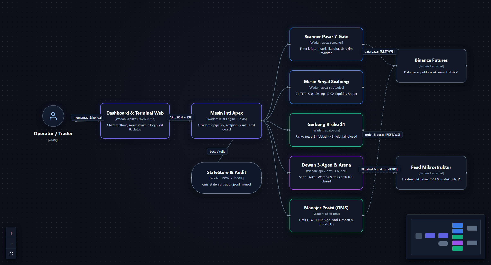
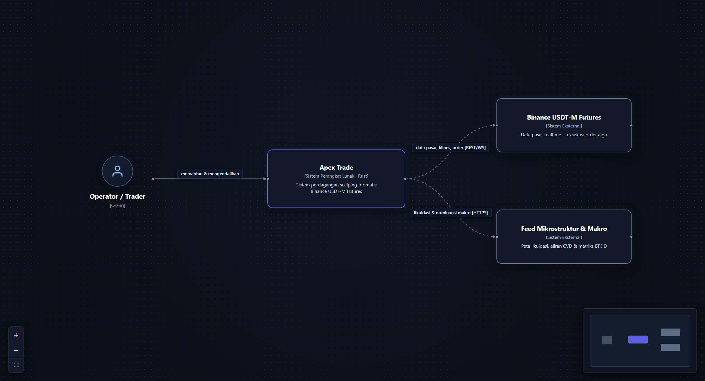
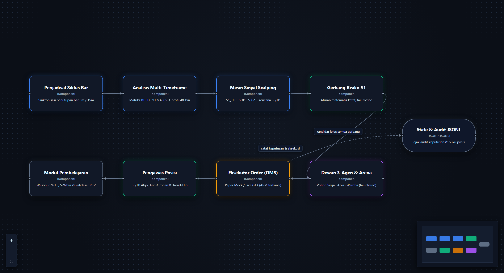
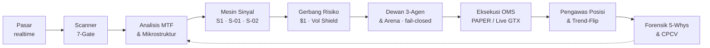
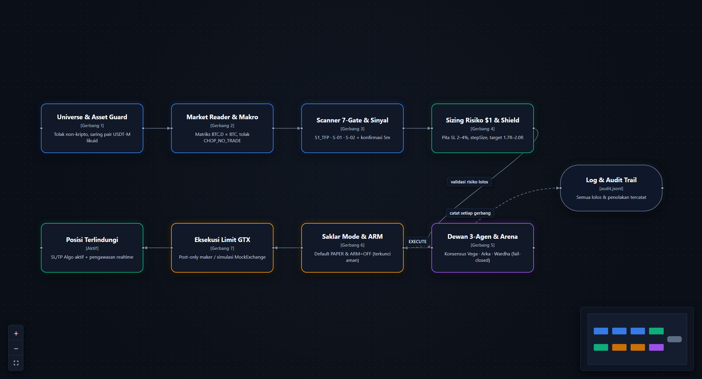
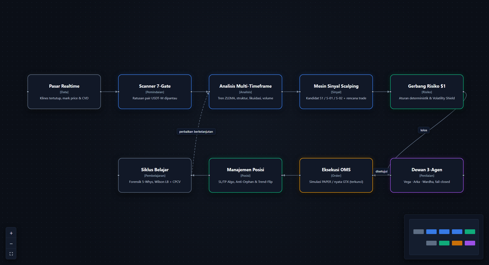

<div align="center">

# Apex Trade

### Sistem Perdagangan Scalping Otomatis untuk Binance USDT-M Futures

**Pemantauan pasar 7-gate · Sinyal scalping multi-timeframe · Dewan penilai 3-agen · Risiko presisi \$1 · Terminal web gelap realtime**

[](LICENSE)
[](https://www.rust-lang.org)
[-2563eb.svg?style=flat-square)](#mode-aman)
[-dc2626.svg?style=flat-square)](#mode-aman)



</div>

---

## Daftar Isi

- [Tentang](#tentang)
- [Fitur Unggulan](#fitur-unggulan)
- [Arsitektur Sistem](#arsitektur-sistem)
- [Cara Kerja](#cara-kerja)
- [Mode Aman](#mode-aman)
- [Instalasi Cepat](#instalasi-cepat)
- [Struktur Proyek](#struktur-proyek)
- [Teknologi](#teknologi)
- [Disclaimer & Lisensi](#disclaimer--lisensi)

---

## Tentang

**Apex Trade** adalah sistem perdagangan otomatis (*high-discipline scalping engine*) berbasis **Rust** untuk pasar **Binance USDT-M Futures**, dirancang dengan tiga prinsip inti: **keselamatan modal lebih dulu, eksekusi deterministik tanpa *look-ahead*, dan setiap keputusan tercatat secara transparan**.

Sistem ini difokuskan murni pada **jalur Scalping (`SCALP`)** — tanpa strategi *swing* — bekerja penuh dari hulu ke hilir: menyaring ratusan kontrak perpetual kripto secara realtime, membaca konteks makro `BTC.D × BTC` serta mikrostruktur orderflow, membangkitkan sinyal lengkap dengan rencana masuk dan keluar presisi, memvalidasi batas risiko matematis \$1 per posisi, menyidangkan kandidat pada **Dewan Penilai 3-Agen + Arena Tesis Arah**, mengeksekusi serta mengawasi posisi terbuka secara otomatis, hingga mengevaluasi hasil lewat forensik *5-Whys* dan validasi *Combinatorial Purged Cross-Validation* (CPCV).

Setiap keputusan sistem — termasuk alasan pasti mengapa sebuah sinyal **dilewati atau ditolak** — ditulis ke log audit JSONL sehingga perilaku mesin selalu dapat diaudit kapan saja.

## Fitur Unggulan

<details open>
<summary><b>📡 Scanner Pasar Realtime 7-Gate & Penjaga Kelas Aset</b></summary>

- Memantau kontrak perpetual USDT-M melalui kombinasi REST dan WebSocket publik dengan *rate-limit guard* otomatis (pelacak bobot `X-MBX-USED-WEIGHT-1M` dan *backoff* mandiri saat HTTP `429`/`418`).
- **Asset Class Guard (*default-deny*)** menyaring kontrak non-kripto (saham, komoditas, indeks TradFi, dan fan token) sebelum masuk ke pemindaian.
- Setiap simbol dievaluasi melewati **7 gerbang kandidat**: likuiditas volume, rezim pasar, arah tren ZLEMA, skor komposit, kelayakan rencana trade, filter *Choppiness Index*, dan batas volatilitas ATR.
</details>

<details open>
<summary><b>🧠 Mesin Sinyal Scalping Multi-Timeframe (Khusus SCALP)</b></summary>

- Menggabungkan konteks makro `1h`, struktur eksekusi `15m`, dan konfirmasi momentum `5m` bersama aliran *Cumulative Volume Delta* (CVD), *Zero-Lag EMA*, profil volume 48-bin (`POC`/`VAH`/`VAL`), dan peta magnet likuidasi.
- Mengoperasikan katalog strategi scalping terfokus: **Trend-Following Pullback (`S1_TFP`)**, **Liquidity Sweep Reclaim (`S01_SWEEP`)**, dan **Liquidity Sniper (`S02_SNIPER`)** — seluruhnya hanya membaca bar yang **sudah tertutup** (*strict closed-bar causality*).
- Setiap sinyal lahir lengkap dengan **harga entri, pita invalidasi SL 2–4%, serta target bertingkat (1.7R–2.0R)**.
</details>

<details open>
<summary><b>⚖️ Gerbang Risiko Deterministik (\$1 Risk & Volatility Shield)</b></summary>

- Menghitung ukuran posisi presisi dari anggaran risiko tetap **\$1.00 per trade** dengan pembulatan `stepSize` dan `tickSize` bursa menggunakan aritmetika desimal eksak (`rust_decimal`).
- **Volatility Shield** otomatis memblokir entri baru saat terjadi lonjakan ATR ekstrem, pelebaran *spread*, atau rezim menyamping (`CHOP_NO_TRADE`).
- Dilengkapi batas posisi terbuka maksimum, jeda pendinginan pasca-*stop-loss*, batas kerugian harian UTC, dan penjaga jarak likuidasi.
</details>

<details open>
<summary><b>🤖 Dewan Penilai 3-Agen & Arena Arah (Fail-Closed)</b></summary>

- **Vega (*Macro Scout*)** — memvalidasi keselarasan posisi altcoin terhadap matriks 6-kondisi `BTC.D × BTC`.
- **Arka (*Setup Judge*)** — mengaudit konfluensi skor setup, kemiripan analog historis (*k-NN*), dan keselarasan orderflow CVD.
- **Wardha (*Risk Officer*)** — menguji kelayakan rasio jarak *stop-loss* terhadap ATR dan memilih varian proteksi struktural terbaik.
- **Arena Tesis Arah (*Bull vs Bear*)** — mempertemukan tesis `LONG` dan `SHORT` di hadapan juri netral. Seluruh lapisan bersifat **fail-closed**: satu *hard veto* atau keraguan langsung membatalkan eksekusi.
</details>

<details open>
<summary><b>🎯 Manajemen Posisi & OMS Otomatis</b></summary>

- Eksekusi entri menggunakan `LIMIT GTX` (*post-only maker*) atau `MARKET` dengan `newClientOrderId` deterministik; status posisi disimpan ke disk **sebelum** paket dikirim ke bursa.
- Proteksi ganda di sisi bursa melalui *Conditional Algo Order* (`MARK_PRICE`, `closePosition=true`), rekonsiliasi posisi yatim (*anti-orphan*) berkala, dan **Trend-Flip Confirmation Guard** yang menutup posisi lebih awal bila tren berbalik selama beberapa bar berturut-turut.
- `MockExchange` mengimplementasikan antarmuka yang identik dengan bursa nyata untuk simulasi `PAPER` yang presisi.
</details>

<details open>
<summary><b>📊 Dashboard & Terminal Web Gelap Realtime</b></summary>

- Antarmuka web bertema gelap (*dark terminal*) dengan grafik kline multi-timeframe bebas *clutter*, pantauan kurva ekuitas, buku posisi terbuka, peta panas likuidasi, dan aliran mikrostruktur.
- Menyediakan endpoint inspeksi langsung untuk tabel pemindaian 7-gate (`/api/markets/scan`), status 21 peran agen (`/api/live/mesh`), audit semesta simbol (`/api/universe/audit`), dan metrik probabilitas (`/api/learning/probability`).
</details>

<details open>
<summary><b>🔁 Siklus Belajar, Forensik 5-Whys & Validasi CPCV</b></summary>

- Setiap perdagangan yang selesai dianalisis otomatis oleh modul **5-Whys Post-Mortem Forensics** dan dihitung batas bawah tingkat kemenangannya menggunakan **Wilson 95% Lower Bound**.
- Mesin *backtest* bebas *look-ahead* mendukung pengujian stres biaya, *Monte Carlo drawdown*, *Deflated Sharpe Ratio* (DSR), serta **Combinatorial Purged Cross-Validation (CPCV)** dengan *embargo* antar-lipatan.
</details>

<details open>
<summary><b>🛡️ Operasional, Watchdog & Ketahanan Sistem</b></summary>

- Skrip `apex_watchdog.ps1` menjaga mesin simulasi dan server dashboard tetap berjalan otomatis, mencegah *host sleep*, serta mengamankan port dashboard dari pembajakan proses asing.
- *Kill switch* berbasis berkas (`state/KILL`) siap menghentikan entri baru atau meratakan posisi kapan pun dibutuhkan operator.
</details>

## Arsitektur Sistem

Dokumentasi arsitektur disusun mengikuti standar **C4 Model** (*Konteks → Wadah → Komponen*) dalam Bahasa Indonesia dengan diagram alur bertema gelap (*dark React Flow*):

| Level | Diagram | Gambar |
|---|---|---|
| 1 | **Konteks Sistem** — interaksi operator, mesin Rust, dan layanan eksternal |  |
| 2 | **Wadah** — pembagian crate Rust, penyimpanan audit, dan terminal web |  |
| 3 | **Komponen** — alur satu kandidat di dalam mesin inti scalping |  |

Penjelasan tiap level: **[docs/id/04-arsitektur-c4.md](docs/id/04-arsitektur-c4.md)**

## Cara Kerja

Secara ringkas, setiap kandidat scalping melewati rantai gerbang satu arah berikut:



Diagram alur rinci dari sinyal hingga siklus hidup perdagangan:

| | |
|---|---|
| Pipeline dari sinyal ke order |  |
| Kehidupan satu perdagangan |  |

Detail lengkap alur kerja: **[docs/id/02-alur-kerja-workflow.md](docs/id/02-alur-kerja-workflow.md)**

## Mode Aman

Keselamatan modal dikunci langsung di tingkat kode sumber:

1. **Mode bawaan = simulasi (`mode = "paper"`).** Seluruh pipeline berjalan utuh — pemindaian pasar publik, sinyal scalping, sidang dewan 3-agen, simulasi `MockExchange`, dan pencatatan audit — **tanpa mengirim satu pun order ke Binance**.
2. **Saklar eksekusi (`arm = false`) terkunci secara bawaan** di `config/engine.toml` dan tidak memiliki flag CLI untuk menyalakannya secara tidak sengaja.
3. **Pengaman berlapis untuk mode `live`**: mesin menolak berjalan di mode nyata kecuali `arm = true`, `--mode live`, dan variabel lingkungan `APEX_LIVE_CONFIRM=I_UNDERSTAND_LIVE_ORDERS` ketiganya aktif secara bersamaan.
4. Kunci API hanya dibaca dari variabel lingkungan proses — tidak pernah dicatat ke log, tidak ditampilkan di dashboard, dan tidak pernah disimpan di repositori.

## Instalasi Cepat

```powershell
git clone https://github.com/Sorosjenaka/Apex-Trade.git
cd Apex-Trade

# Build binary teroptimasi & jalankan seluruh unit test workspace
cargo build --release --bin apex
cargo test --workspace

# Jalankan mesin scalping dalam mode simulasi aman (PAPER)
.\target-msvc\release\apex.exe run --mode paper

# Di terminal terpisah, nyalakan Dashboard & Terminal Web (port 8787)
python dashboard\server.py
```

Buka browser ke `http://127.0.0.1:8787` untuk memantau terminal pasar, posisi simulasi, serta telemetri mesin secara langsung.

Panduan pemasangan lengkap langkah demi langkah (termasuk watchdog otomatis, backtest, dan prosedur keamanan):
**[docs/id/03-tutorial-pasang.md](docs/id/03-tutorial-pasang.md)**

## Struktur Proyek

```text
Apex-Trade/
├── apps/
│   └── apex/                 # Binary CLI utama: run (paper/testnet/live), backtest, validate, screen
├── crates/
│   ├── core/                 # Tipe dasar, sizing risiko $1 (rust_decimal), filter presisi & audit JSONL
│   ├── indicators/           # ZLEMA, ATR, ADX, Choppiness, Volume Profile 48-bin, Fib & MRV Gate
│   ├── data/                 # Klien REST/WebSocket publik Binance (rustls), CSV & cache klines
│   ├── market_reader/        # Deteksi rezim pasar global & konteks dominansi BTC
│   ├── screener/             # Asset Class Guard, Volume Gate, Scanner 7-Gate, LiqMap & Orderflow Delta
│   ├── strategies/           # Strategi scalping tertutup: S1_TFP, S01_SWEEP, S02_SNIPER & k-NN analog
│   ├── backtest/             # Simulator bebas look-ahead, Monte Carlo, PSR/DSR & validasi CPCV
│   └── oms/                  # Order Management System, MockExchange, Dewan 3-Agen, Rate Guard & 5-Whys
├── config/                   # Konfigurasi engine.toml (arm=false), risk.toml, screener.toml, strategies.toml
├── dashboard/                # Server HTTP/SSE ringan & antarmuka terminal web gelap (:8787)
├── scripts/                  # Skrip operasional & watchdog proses otomatis (PowerShell)
├── docs/
│   ├── id/                   # Panduan lengkap Bahasa Indonesia ← mulai dari sini
│   ├── public/               # Dokumentasi arsitektur teknis (Bahasa Inggris)
│   └── diagrams/             # Diagram arsitektur C4, pipeline, dan workflow versi gelap
└── .env.example              # Template variabel lingkungan (tanpa rahasia)
```

## Teknologi

| Lapisan | Teknologi |
|---|---|
| Mesin inti & eksekusi | **Rust** (Edition 2021, ≥ 1.85), **Tokio** async runtime |
| Presisi finansial & TLS | `rust_decimal` (desimal eksak), `reqwest` + `tokio-tungstenite` (`rustls`, murni tanpa OpenSSL) |
| Penyimpanan & jejak audit | State atomik JSON (`oms_state.json`) & *append-only* JSONL (`audit.jsonl`) |
| Terminal & dashboard web | Python `ThreadingHTTPServer` + SSE, HTML5/CSS3 Dark UI, Lightweight Charts |
| Data pasar & bursa | Binance USDT-M Futures (REST + WebSocket publik & terautentikasi HMAC-SHA256) |
| Validasi kuantitatif | Event-driven Backtester, Combinatorial Purged Cross-Validation (CPCV), Wilson 95% LB |
| Arsitektur dokumentasi | C4 Model & Mermaid |

## Disclaimer & Lisensi

> Perdagangan kontrak berjangka (*futures*) aset kripto memiliki risiko tinggi dan dapat mengakibatkan kehilangan seluruh modal. Perangkat lunak ini disediakan **apa adanya (*as-is*)** untuk tujuan riset dan rekayasa sistem tanpa jaminan apa pun. Seluruh keputusan penggunaan menjadi tanggung jawab penuh pengguna. Kinerja simulasi maupun pengujian masa lalu tidak menjamin hasil di masa depan.

Didistribusikan di bawah lisensi **MIT** — lihat [LICENSE](LICENSE).
