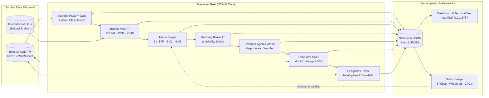
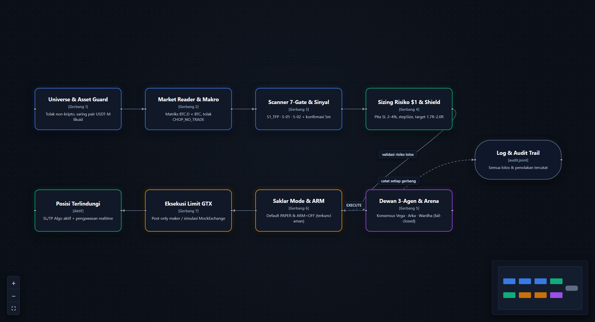
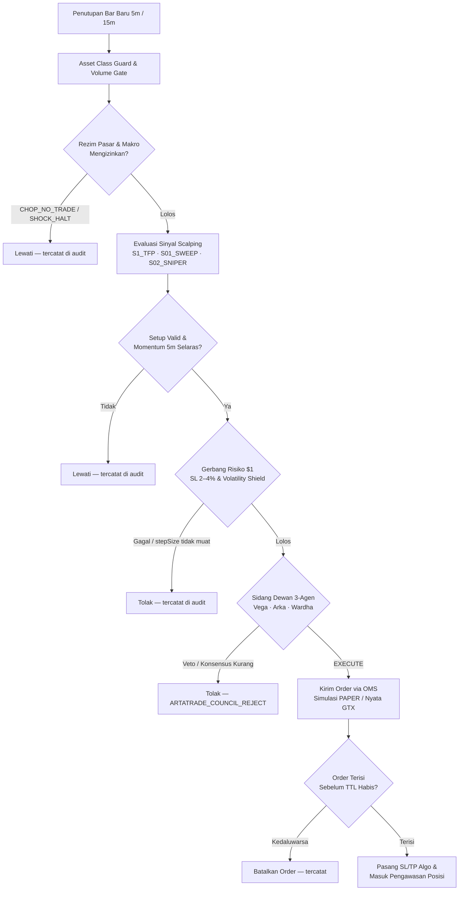
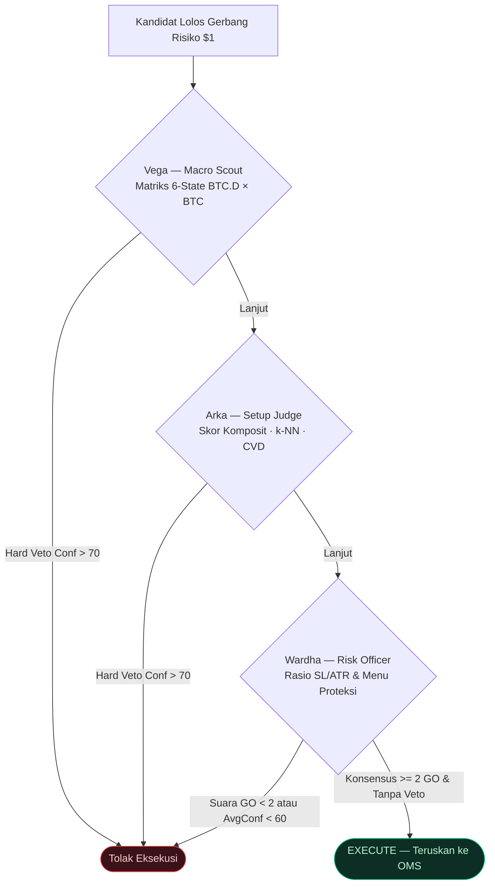
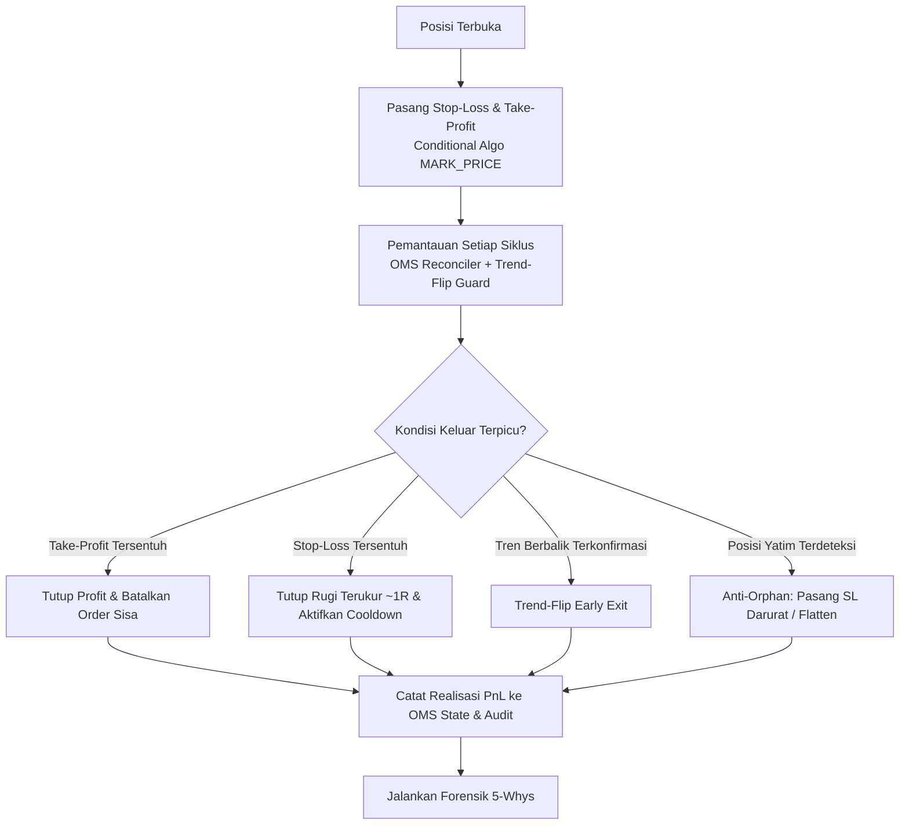
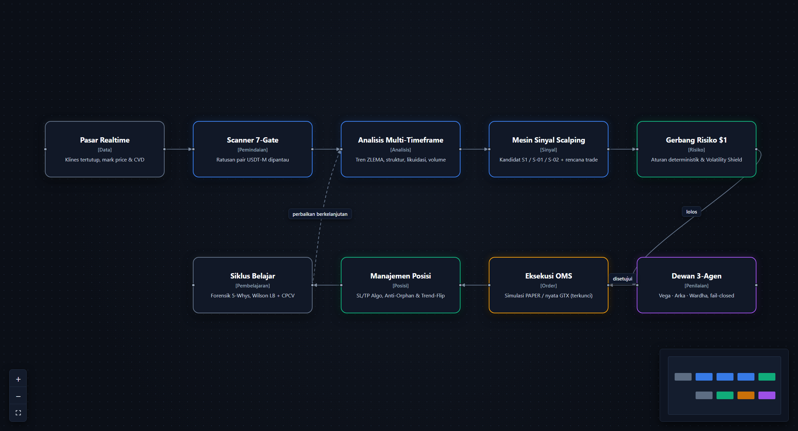
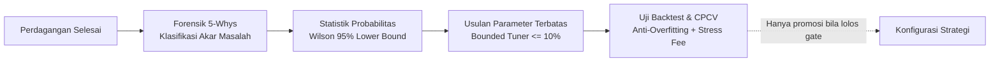

# Alur Kerja dan Struktur Workflow

Dokumen ini menguraikan struktur komponen dan alur kerja lengkap **Apex Trade** dari pembacaan pasar hingga siklus pembelajaran pasca-perdagangan.

Gambar diagram alur resolusi penuh (tema gelap):

- Pipeline Sinyal ke Order: [apex-pipeline-id.png](../diagrams/apex-pipeline-id.png)
- Kehidupan Satu Perdagangan: [apex-workflow-id.png](../diagrams/apex-workflow-id.png)

---

## 1. Struktur Hubungan Antarkomponen

---

## 2. Pipeline Perdagangan (Dari Sinyal ke Posisi)

Setiap kandidat wajib melewati seluruh gerbang secara berurutan. Kegagalan pada salah satu tahap langsung menghentikan kandidat dan mencatat alasan penolakannya di `audit.jsonl`.

---

## 3. Alur Sidang Dewan 3-Agen (*Fail-Closed*)

---

## 4. Manajemen Posisi Terbuka & Proteksi

---

## 5. Siklus Belajar & Validasi Statistik

Untuk panduan instalasi dan pengoperasian harian, lanjutkan ke [03-tutorial-pasang.md](03-tutorial-pasang.md).
