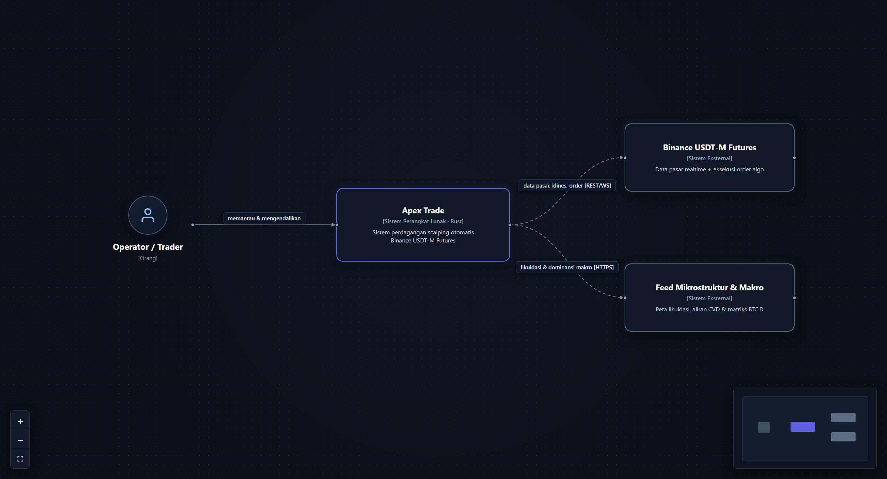
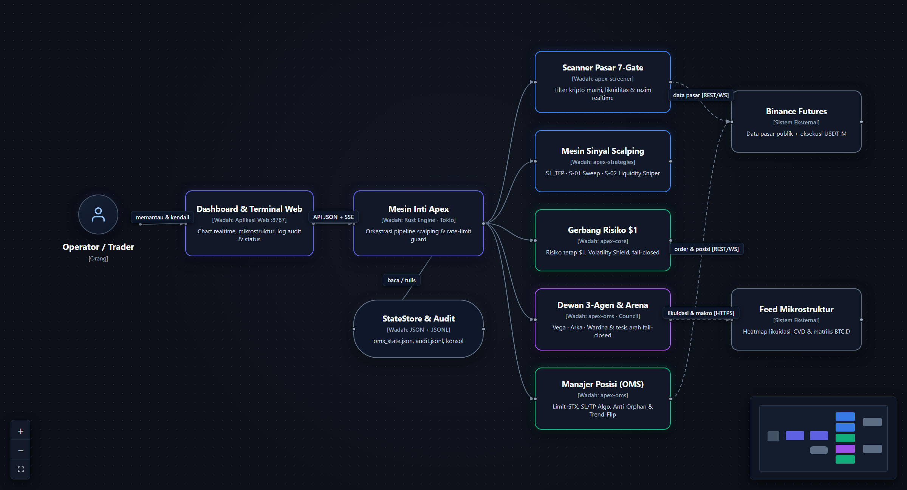
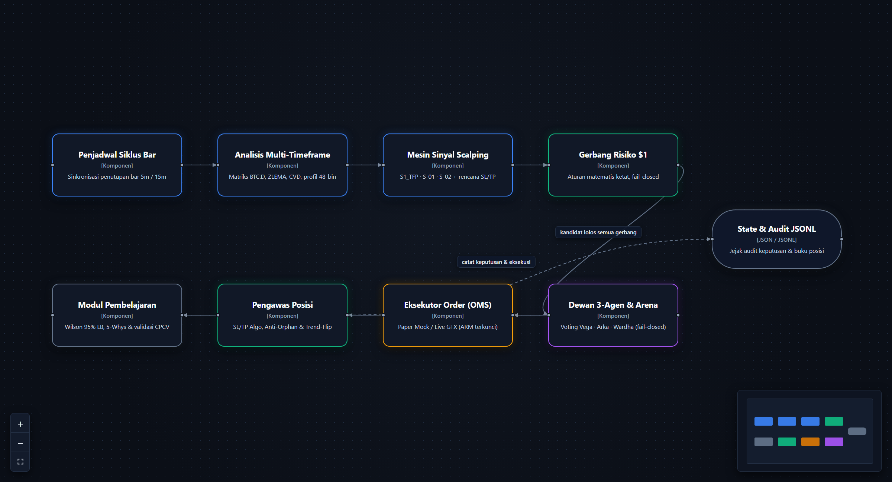

# Arsitektur Sistem (Model C4)

Dokumen ini memetakan arsitektur **Apex Trade** menggunakan pendekatan **C4 Model** dalam tiga tingkat kedalaman: **Konteks Sistem → Wadah (*Container*) → Komponen**. Seluruh diagram dirender dalam tema gelap (*dark React Flow*).

---

## Level 1 — Konteks Sistem

> *Siapa operator sistem ini, dan layanan eksternal apa saja yang berinteraksi dengannya?*

- **Operator / Trader** — memantau metrik kinerja lewat terminal web, meninjau audit penolakan, serta memegang kendali eksklusif atas berkas konfigurasi dan saklar `arm`.
- **Apex Trade (Rust)** — sistem perdagangan scalping mandiri yang menjalankan pemindaian, analisis multi-timeframe, perhitungan risiko \$1, sidang dewan 3-agen, dan pengelolaan posisi.
- **Binance USDT-M Futures** — sumber data klines, *ticker* 24 jam, dan *mark price* publik sekaligus tujuan pengiriman order ketika mode terautentikasi diaktifkan.
- **Feed Mikrostruktur & Makro** — sumber pelengkap untuk pembacaan peta likuidasi serta konteks dominansi pasar (`BTC.D`).

---

## Level 2 — Wadah (*Container*)

> *Unit teknis dan crate utama apa saja yang menyusun Apex Trade?*

| Wadah / Crate | Tanggung Jawab |
|---|---|
| **Dashboard & Terminal Web (`dashboard/`)** | Server HTTP + SSE ringan (`:8787`) dengan grafik kline gelap realtime, inspeksi konsol agen, dan pemantauan kurva ekuitas |
| **Mesin Inti Apex (`apps/apex`)** | Orkestrator siklus asinkron berbasis Tokio, CLI multi-perintah, dan pengatur *rate-limit* |
| **Scanner Pasar 7-Gate (`apex-screener`)** | *Asset Class Guard* kripto murni, *Volume Gate*, pemindai kandidat 7-gerbang, peta likuidasi, dan *orderflow delta* |
| **Mesin Sinyal Scalping (`apex-strategies` + `apex-indicators`)** | Evaluasi tertutup `S1`–`S5` (backtest + live) serta `S01_SWEEP` dan `S02_SNIPER` (live/paper, `has_backtest=false`) beserta ZLEMA, profil volume 48-bin, Fib, dan analog *k-NN* |
| **Gerbang Risiko \$1 (`apex-core`)** | Perhitungan kuantitas berbasis `rust_decimal`, pita SL 2–4%, pembulatan `stepSize`/`tickSize`, dan *Volatility Shield* |
| **Dewan Deterministik & Arena Advisory (`apex-oms::artatrade_exec`)** | Aturan deterministik pra-eksekusi (*Vega*, *Arka*, *Wardha*, `enforced=true`) dan arena tesis arah (*Bull vs Bear*, `enforced=false` / *advisory*) |
| **Manajer Posisi / OMS (`apex-oms`)** | Pengiriman order idempoten (`MockExchange` / `BinanceLive`), pemasangan SL/TP Algo, rekonsiliasi anti-yatim, dan *Trend-Flip Guard* |
| **StateStore & Audit (`state/`)** | Penyimpanan atomik `oms_state.json`, log *append-only* `audit.jsonl`, dan snapshot telemetri `artatrade_console.json` |

---

## Level 3 — Komponen (Alur di Dalam Mesin Inti)

> *Bagaimana satu kandidat mengalir langkah demi langkah di dalam siklus mesin?*

1. **Penjadwal Siklus Bar** — menyelaraskan evaluasi tepat setelah penutupan bar `5m` dan `15m`.
2. **Analisis Multi-Timeframe** — menyatukan rezim makro `1h` (`BTC.D × BTC`), tren ZLEMA `15m`, aliran CVD, dan distribusi volume 48-bin.
3. **Mesin Sinyal Scalping** — menghasilkan kandidat berarah lengkap dengan level entri, invalidasi SL struktural, dan target R-multiple.
4. **Gerbang Risiko \$1** — memverifikasi jarak SL 2–4%, eksposur margin, serta ketiadaan blokir *Volatility Shield*.
5. **Dewan 3-Agen & Arena** — melakukan pemungutan suara tiga peran independen; ketidakselarasan makro atau kualitas setup rendah otomatis memicu penolakan.
6. **Eksekutor Order (OMS)** — mengeksekusi simulasi di `MockExchange` (`PAPER`) atau mengirim `LIMIT GTX` ke bursa bila seluruh kunci `LIVE` aktif.
7. **Pengawas Posisi** — memelihara order proteksi SL/TP di sisi bursa, mendeteksi posisi yatim, dan mengeksekusi keluar dini saat terjadi pembalikan tren terkonfirmasi.
8. **Modul Pembelajaran** — menjalankan forensik *5-Whys*, menghitung *Wilson 95% Lower Bound*, dan menguji perubahan parameter melalui *backtest* + **CPCV**.

---

## Prinsip Rekayasa Utama

- **Kausalitas Bar Tertutup (*Zero Look-Ahead*)** — indikator dan strategi tidak pernah mengintip kline yang masih berjalan.
- **Fail-Closed di Setiap Batas Keputusan** — data basi, *stepSize* tidak mencukupi untuk risiko \$1, atau veto salah satu agen berarti tidak ada posisi yang dibuka.
- **Auditabilitas Penuh** — baik sinyal yang dieksekusi maupun yang dilewati tercatat rapi beserta alasannya di `audit.jsonl`.

Kembali ke [indeks panduan Bahasa Indonesia](README.md).
